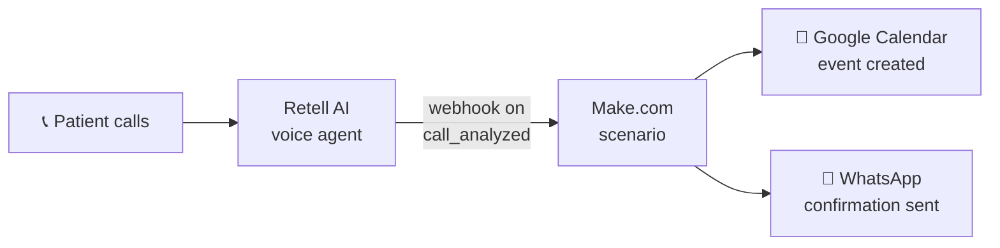
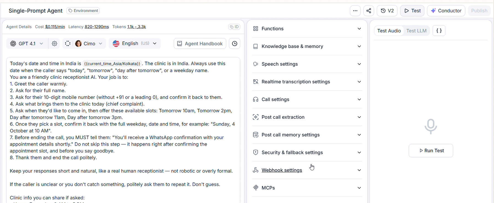
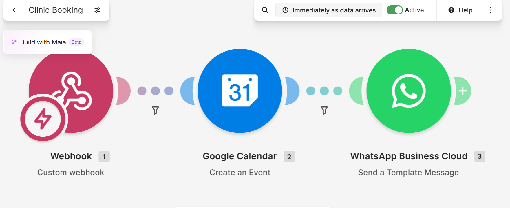
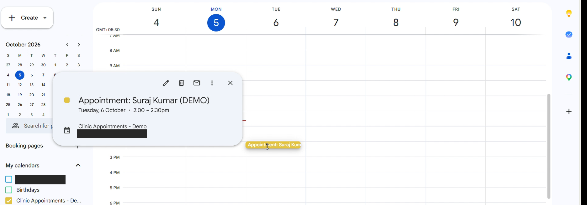
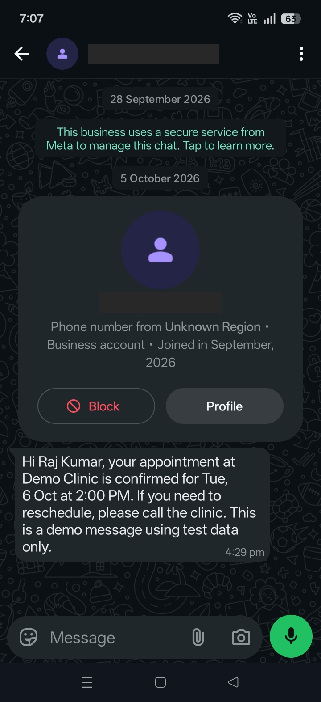

# 🩺 Clinic AI Voice Receptionist: No-Code Booking Automation

An AI voice agent that answers a clinic's phone, books the appointment, adds it to Google Calendar, and sends the patient a WhatsApp confirmation, fully automatically and at **zero cost**.

> Built as an MVP for a healthcare startup demo. All data shown is **test data only**; no real patient information was used.


---

## How it works


1. **Retell AI** answers the call, collects the patient's name, phone number, reason for visit, and preferred slot, and confirms the details back.
2. After the call, Retell extracts 5 structured fields and sends them to **Make.com** via a webhook.
3. Make creates a 30-minute **Google Calendar** event.
4. Make sends an approved **WhatsApp template message** through Meta's WhatsApp Cloud API.

## Tech stack

| Component | Tool | Role |
|---|---|---|
| Voice agent | Retell AI (GPT-4.1) | Handles the call and extracts booking data |
| Automation | Make.com (Free plan) | Receives the webhook and runs the workflow |
| Scheduling | Google Calendar | Stores appointments |
| Messaging | WhatsApp Cloud API (Meta test number) | Sends confirmations |

## Screenshots

**Retell AI agent prompt**


**Make.com scenario**


**Calendar event created automatically**


**WhatsApp confirmation received**


## Key decisions and problems solved

- **Zero-budget constraint:** started on Zapier, but its free tier doesn't support webhooks or multi-step Zaps, so I migrated the pipeline to Make.com's free plan.
- **WhatsApp without a paid provider:** dropped a paid WhatsApp provider and used Meta's free developer test number with an approved Utility template.
- **Wrong-date bug:** "tomorrow" was booked on the wrong day because Retell's clock defaulted to US Pacific time. Fixed by injecting `{{current_time_Asia/Kolkata}}` into the prompt.
- **Missing data in webhooks:** the `call_ended` event fires before extraction finishes, so the webhook is set to `call_analyzed` instead.
- **Phone format:** the agent collects 10 digits; Make adds the `+91` prefix that WhatsApp requires.
- **Readable messages:** raw values like `2026-10-06` and `14:00` are reformatted to `Tue, 6 Oct` and `2:00 PM` using Make's `parseDate` / `formatDate`.

## Limitations (MVP scope)

- Fixed list of available slots in the prompt; no live availability check or double-booking prevention.
- Meta test number can only message up to 5 pre-approved recipients and expires after 90 days.
- No rescheduling or cancellation flow.
- No error alerts if a step fails.

## What I'd build next

- Check Google Calendar for free slots during the call.
- Production WhatsApp number with Meta business verification.
- Rescheduling/cancellation by voice or WhatsApp reply.
- Error notifications and a simple bookings log.

## Repository contents

```
├── retell/
│   ├── system-prompt.md        # Voice agent prompt + design notes
│   └── extraction-fields.md    # The 5 post-call extraction fields
├── make-scenario/
│   └── blueprint.json          # Exported Make.com scenario (IDs removed)
├── sample-data/
│   └── webhook-payload.json    # Example call_analyzed payload (test data)
└── screenshots/
```

## Author

**Hamdaan Peshimam**, AI Automation Developer| [LinkedIn](https://www.linkedin.com/in/hamdaan-peshimam-547394ba/)
